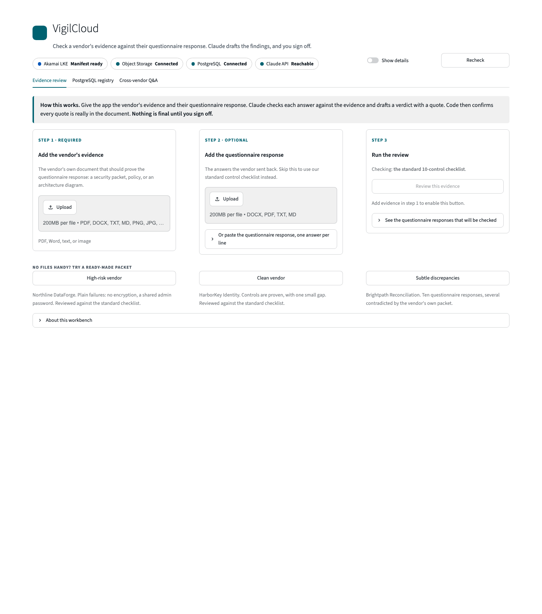
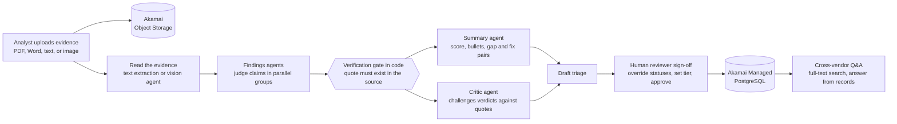
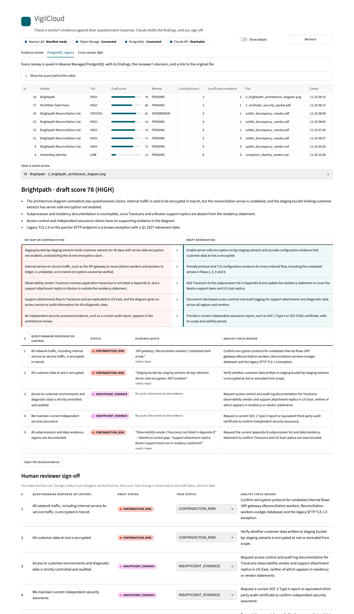

# VigilCloud

**A multi-agent workbench that checks a vendor's evidence against their questionnaire response, so a third-party risk (TPRM) analyst reviews contradictions and gaps instead of reading every page.**

Claude drafts the findings. Code checks every quote. A second agent challenges the verdicts. The analyst makes the final call, and that decision is saved.



## The problem

Before a company hires a vendor that will see customer data, someone has to decide whether that vendor is safe to use. The vendor sends two things:

- a **questionnaire response**, which says what they do ("all customer data is encrypted at rest"), and
- **evidence**, which is the documents that should prove it (a security packet, a policy, an architecture diagram).

Today an analyst reads both and lines them up by hand.

- It takes hours for one vendor.
- Two reviewers can reach two different answers.
- A contradiction buried on page six is easy to miss.
- If the company signs anyway, it finds the gap after an incident, not before the contract.

## The solution

VigilCloud gives every vendor the same first pass and keeps the original file and the decision.

| For the organization | For the TPRM analyst |
|---|---|
| The same first review for every vendor | No more hunting through a packet for each answer |
| The original evidence and the sign-off are both stored | Each response comes back with a status, a quote from the evidence, and the next thing to ask for |
| Leadership can see which vendors are high risk, which answers were never proven, and who signed off | Contradictions and missing proof are called out |
| The review is faster and can be audited later | The draft is labeled as a draft. The analyst's call is what gets saved |

Every finding gets one of four statuses:

| Status | Meaning |
|---|---|
| `SUPPORTED` | The evidence backs the response |
| `PARTIAL_OR_AMBIGUOUS` | The evidence backs part of it, or is unclear |
| `CONTRADICTION_RISK` | The evidence conflicts with the response |
| `INSUFFICIENT_EVIDENCE` | The evidence says nothing about it. This is treated as unproven, never as compliant |

The draft triage gets a risk score and a tier (`LOW`, `MEDIUM`, `HIGH`, `CRITICAL`) and is always labeled **Draft Triage Assistance — Requires Human TPRM Sign-Off**.

## How it works

VigilCloud is multi-agent. Each agent has one job, and plain code sits between them.



1. **Upload and store.** The original file goes to a private Akamai Object Storage bucket. The analyst can open it later through a temporary signed link.
2. **Read.** Text is pulled out of PDF, Word, and text files. For an image such as an architecture diagram, a vision agent reads the picture into text. The review then runs on that text.
3. **Judge.** The questionnaire responses are split into small groups and findings agents judge the groups in parallel. Each finding has a status, a verbatim quote from the evidence, and the check an analyst should run next.
4. **Verify in code.** This step is not a model. Every quote is searched for in the original text. A quote that is missing or not found downgrades the finding to `INSUFFICIENT_EVIDENCE`, and the model's original status is kept for audit. Any response the model failed to answer is added as `INSUFFICIENT_EVIDENCE`, so nothing is dropped.
5. **Summarize and challenge, together.** A summary agent writes the score, a short bulleted summary, and up to five gap and remediation pairs. At the same time a critic agent checks that statuses match their quotes and do not overstate certainty. It returns `PASS`, `WARN`, or `FAIL`. If the critic fails to run, the review keeps going and shows the critic as skipped.
6. **Human sign-off.** The analyst changes any status they disagree with, sets the final tier, adds a note, and saves. The record is stored as `OVERRIDDEN`, `APPROVED`, or `PENDING`. The draft status stays next to the analyst's status.
7. **Ask across vendors.** Full-text search finds matching findings and evidence passages across every saved review. Claude answers only from those records, and says so when the records do not contain the answer.

Nothing is written to PostgreSQL until the schema check passes.



### Where each service is used

| Service | Job |
|---|---|
| Akamai Object Storage | Stores the original evidence privately and serves temporary signed links |
| Akamai Managed PostgreSQL | Stores assessments, findings, reviewer decisions, and evidence chunks, with full-text search (generated `tsvector` columns and GIN indexes) |
| Akamai Kubernetes (LKE) | Runs the container. `k8s/deployment.yaml` loads settings from a Kubernetes secret |
| Claude (Anthropic API) | Findings, summary, critic, image reading, and Q&A. Structured output comes from forced tool calls validated with Pydantic |

### The app

The Streamlit app has three tabs:

- **Evidence review.** Three steps: add the vendor's evidence, optionally add the questionnaire response (upload it, paste it, or use a standard 10-control checklist), then run the review. Ready-made sample packets are included.
- **PostgreSQL registry.** Every saved review, with tier, sign-off state, and counts of contradicted and unproven responses. Open one to see the full draft and sign-off form.
- **Cross-vendor Q&A.** Ask a question across all saved reviews.

A status strip at the top shows whether Object Storage, PostgreSQL, and Claude are reachable.

## Run it locally

You need Python 3.11 or newer, [uv](https://docs.astral.sh/uv/), an Anthropic API key, an Akamai Managed PostgreSQL database, and an Akamai Object Storage bucket.

```bash
cp .env.example .env        # then fill in the values
uv sync
uv run streamlit run app.py
```

Open http://localhost:8501. The tables and indexes are created on first use.

A review takes about 10 to 25 seconds for text and PDF evidence, and about 30 seconds for an image, because the vision agent reads the picture first. Setting `SUMMARY_MODEL` to a faster model speeds up the summary step only. The verdict on each response always uses `CHAT_MODEL`.

## Deploy to Akamai LKE

```bash
docker build --platform linux/amd64 -t YOUR_REGISTRY/vigilcloud:latest .
docker push YOUR_REGISTRY/vigilcloud:latest

# Put the image name in k8s/deployment.yaml, then:
kubectl create secret generic app-env --from-env-file=.env
kubectl apply -f k8s/deployment.yaml
```

The pod reads its settings from the `app-env` secret. `.env` is never copied into the image and is never committed.

## Try it with the demo files

| File | What it shows |
|---|---|
| `samples/` | Three ready-made packets, also available as buttons in the app: a high-risk vendor, a clean vendor, and a vendor with subtle discrepancies (Brightpath) |
| `demo_evidence/Final_demo/` | NorthStar security packet and questionnaire (gaps and a disagreement), plus a Brightpath architecture diagram and questionnaire (a picture as evidence) |
| `demo_evidence/*.docx` | Word versions of the NorthStar and Brightpath files |

All vendors and documents in this repo are fictional. To regenerate the PDFs, Word files, and diagram, run `uv run --group dev python scripts/make_demo_evidence.py`.

## Project layout

```
app.py                    Streamlit UI: tabs, review flow, sign-off, registry, Q&A
inference_verifier.py     Agents, schemas, verification gate, critic, claim parsing
db.py                     PostgreSQL schema, queries, full-text search
storage.py                Object Storage upload and signed links
settings.py               Environment settings
sample_catalog.py         The ready-made sample packets
k8s/deployment.yaml       LKE deployment and service
scripts/                  Demo file generator
```

## Limits

- Search matches words, not meaning.
- A vendor is not re-checked when a new document arrives.
- There is no login.
- The risk score and tier are a draft until a person signs them.
- Claude can move a score by about 10 points between runs. The quote check and the reviewer are what keep the result honest.
